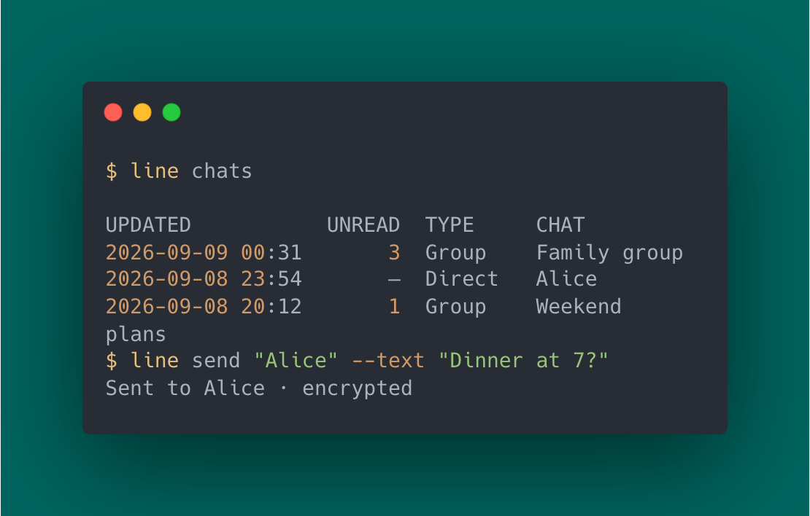

# LINE CLI: ไคลเอนต์บรรทัดคำสั่งสำหรับบัญชี LINE ส่วนตัว

[English](README.md) | [繁體中文（台灣）](README.zh-TW.md) | [日本語](README.ja.md) | ภาษาไทย

**LINE CLI** เป็น CLI แบบไม่เป็นทางการที่เขียนด้วย Go สำหรับใช้บัญชี LINE ส่วนตัวผ่านเทอร์มินัล
อ่านแชท ส่งข้อความและไฟล์ ดาวน์โหลดไฟล์แนบ และรับเหตุการณ์แบบเรียลไทม์ได้
รองรับ **macOS, Linux และ Windows** พร้อมการป้อนข้อมูลแบบโต้ตอบหรือผลลัพธ์ JSON
ไม่ต้องมีบัญชีบอตหรือตั้งค่า LINE Messaging API

[](https://github.com/kongesque/line-cli/actions/workflows/cli.yml)
[](https://github.com/kongesque/line-cli/releases/latest)
[](go.mod)
[](LICENSE)

[ติดตั้ง](#install-line-cli) · [เริ่มใช้งาน](#quick-start-send-your-first-line-message) · [คำสั่ง](#line-messaging-commands) · [ระบบอัตโนมัติ](#automate-line-with-json-and-shell-scripts) · [คู่มือฉบับเต็ม](docs/CLI.th.md)



README นี้อธิบายสาขาที่กำลังพัฒนา สำหรับเวอร์ชันที่เผยแพร่แล้ว ให้ดู README ในแท็กนั้น
และ `line COMMAND --help` ดู[บันทึกการเปลี่ยนแปลง](CHANGELOG.md)

<a id="install-line-cli"></a>

## ติดตั้ง LINE CLI

### macOS: Homebrew

```sh
brew install kongesque/tap/line-cli
```

### macOS และ Linux: ตัวติดตั้งไบนารีแบบ standalone

```sh
curl --proto '=https' --tlsv1.2 -fsSL https://raw.githubusercontent.com/kongesque/line-cli/main/scripts/install-release.sh | sh
```

ตัวติดตั้งจะตรวจหาระบบปฏิบัติการและสถาปัตยกรรม CPU ตรวจสอบ checksum ของรีลีส
และติดตั้ง `line` ลงใน `~/.local/bin` หากมีคำแนะนำให้เปิดเทอร์มินัลใหม่
ให้ทำตามเพื่อใช้การตั้งค่า `PATH`
หากต้องการใช้ใน shell ปัจจุบันทันที ให้รัน `export PATH="$HOME/.local/bin:$PATH"`

**Linux เดสก์ท็อป:** บน Debian หรือ Ubuntu ให้ติดตั้งแพ็กเกจเก็บข้อมูลรับรองก่อนเข้าสู่ระบบ:

```sh
sudo apt install libsecret-tools gnome-keyring
```

เรียก `line` จากเซสชันเดสก์ท็อปที่มี Secret Service keyring ทำงานและปลดล็อกอยู่
ในเซสชัน D-Bus เดียวกัน หากใช้เซิร์ฟเวอร์หรือ SSH ที่ไม่มี keyring ของเดสก์ท็อป
ให้ใช้วิธีเข้าสู่ระบบแบบ headless ด้านล่าง

### Windows: PowerShell

```powershell
irm https://raw.githubusercontent.com/kongesque/line-cli/main/scripts/install-release.ps1 | iex
```

ตัวติดตั้งจะตรวจสอบ checksum และเพิ่ม `line.exe` ลงใน `PATH` ของผู้ใช้
เปิด PowerShell ใหม่หากจำเป็น Windows ไม่ต้องติดตั้งแพ็กเกจ keyring เพิ่มเติม

คุณยังสามารถ[ดาวน์โหลดรีลีส](https://github.com/kongesque/line-cli/releases/latest)
หรือ[บิลด์จากซอร์สโค้ด](#build-and-contribute)ได้ ไบนารีของรีลีสยังไม่มีลายเซ็นดิจิทัล
และยังไม่ได้ผ่าน notarization

ตรวจสอบการติดตั้ง:

```sh
line version
```

<a id="quick-start-send-your-first-line-message"></a>

## เริ่มใช้งาน: ส่งข้อความ LINE แรกของคุณ

> [!IMPORTANT]
> การเข้าสู่ระบบอาจแทนที่เซสชันเดิมของส่วนขยาย LINE สำหรับ Chrome หรือไคลเอนต์อื่น
> ที่ใช้เซสชันแบบ Chrome โดย LINE CLI จะบันทึกได้หนึ่งบัญชีต่อผู้ใช้ระบบปฏิบัติการ

### 1. ลงชื่อเข้าใช้ด้วย LINE บนโทรศัพท์

```sh
line login
```

ใช้ตัวสแกนใน LINE บนโทรศัพท์สแกน QR code ที่แสดงในเทอร์มินัล อนุมัติการเข้าสู่ระบบ
และกรอก PIN ที่แสดงหากระบบขอ รอจนเห็นข้อความ **Session saved securely**
การเข้าสู่ระบบด้วย QR ยังเป็นฟีเจอร์ทดลองและต้องเปิดใช้งาน Letter Sealing

หากบัญชี LINE ตั้งค่าอีเมลและรหัสผ่านไว้แล้ว สามารถใช้วิธีนี้แทนได้ รวมถึงเมื่อเข้าสู่ระบบด้วย QR ไม่สำเร็จ:

```sh
line login --email you@example.com
```

ป้อนรหัสผ่านที่ช่องรับข้อมูลซึ่งไม่แสดงสิ่งที่พิมพ์ และยืนยันบนโทรศัพท์หากระบบขอ รหัสผ่านจะไม่ถูกบันทึก

<details>
<summary>เซิร์ฟเวอร์ Linux หรือ SSH: เข้าสู่ระบบโดยไม่ใช้ keyring ของเดสก์ท็อป</summary>

ใช้บัญชี Unix ปกติและเทอร์มินัลแบบโต้ตอบ หากเชื่อมต่อจากระยะไกล ใช้ `ssh -t user@host`
ที่เก็บแบบ headless ต้องมี `/usr/bin/systemd-creds` จาก systemd 256–259
และบริการ user credential broker ที่ทำงานได้

```sh
line login --headless
```

หากใช้อีเมลและรหัสผ่าน ให้ใช้ `line login --headless --email you@example.com` แทน
ยอมรับ **Host key; no TPM** เมื่อระบบถาม ที่เก็บนี้ไม่ป้องกันการคัดลอกดิสก์ทั้งลูกและไม่มีการป้องกันด้วย TPM
การตั้งค่าครั้งแรกยังต้องโต้ตอบในเทอร์มินัลและอนุมัติบนโทรศัพท์

รอจนเห็น **Session saved securely** แล้วรัน `line auth status --check`
จากนั้นใช้คำสั่งด้านล่างด้วยบัญชี Unix เดิม โดยไม่ต้องเพิ่ม `--headless`

</details>

### 2. ดูห้องแชทและส่งข้อความ

```sh
line whoami     # ตรวจสอบบัญชีที่ลงชื่อเข้าใช้
line chats      # แสดงรายการห้องแชท
line messages   # เลือกห้องแชทและอ่านข้อความล่าสุด
line send       # เลือกผู้รับและพิมพ์ข้อความ
```

ในเทอร์มินัลแบบโต้ตอบ CLI จะถามข้อมูลที่ยังไม่ได้ระบุ ใช้ Ctrl-C เพื่อยกเลิก
หรือระบุชื่อห้องแชทโดยตรงตามตัวอย่างด้านล่าง

เมื่อส่งสำเร็จจะแสดง `Sent to … · end-to-end encrypted` หรือ
`Sent to … · transport encrypted (no E2EE)`

<a id="line-messaging-commands"></a>

## คำสั่งสำหรับข้อความ LINE

| สิ่งที่ต้องการทำ | คำสั่ง |
| --- | --- |
| ค้นหาเพื่อน | `line contacts --search "Alice"` |
| อ่านข้อความล่าสุด | `line messages "Alice" --limit 20` |
| ส่งข้อความ | `line send "Alice" --text "Hello!"` |
| ส่งไฟล์ | `line send "Alice" --file ./report.pdf` |
| ดาวน์โหลดรูปภาพ วิดีโอ เสียง หรือไฟล์ | `line download` |
| รับเหตุการณ์แบบเรียลไทม์ | `line watch` |

แทนที่ `Alice` ด้วยชื่อแชทเต็มที่ไม่ซ้ำกับแชทอื่น (ไม่แยกตัวพิมพ์เล็กและใหญ่) หรือใช้ chat ID แบบเต็ม
หากชื่อซ้ำ ให้รัน `line chats --search "Alice" --show-ids` แล้วใช้ ID แบบเต็มที่แสดง
ดูตัวเลือกด้วย `line COMMAND --help` ส่วนการตอบกลับ แสดงความรู้สึก และแบ่งหน้าประวัติอยู่ใน
[คู่มือ CLI](docs/CLI.th.md#daily-commands)

<a id="automate-line-with-json-and-shell-scripts"></a>

## ทำงานอัตโนมัติบน LINE ด้วย JSON และ shell script

เพิ่ม `--json` เพื่อส่งข้อมูลแบบมีโครงสร้างออกทาง stdout ส่วนข้อความแจ้งสถานะและข้อผิดพลาดจะออกทาง stderr
`--json` และ `--stdin` ปิดการถามข้อมูลแบบโต้ตอบ จึงต้องระบุอาร์กิวเมนต์ที่จำเป็นทั้งหมด
ใช้ chat ID แบบเต็มในสคริปต์ เพราะชื่ออาจเปลี่ยนได้

```sh
line chats --search "Family" --json
line messages CHAT_ID --limit 20 --json
line send CHAT_ID --stdin --json < message.txt
line watch --json > events.ndjson
```

หา `CHAT_ID` จาก `line chats --json` ผลลัพธ์เหตุการณ์เป็น NDJSON โปรแกรมที่อ่านข้อมูลควรตัดรายการซ้ำด้วย revision
ดูฟิลด์และรูปแบบข้อผิดพลาดใน[ข้อมูลอ้างอิง JSON](docs/JSON.md)

การเปลี่ยนแปลงข้อมูลฝั่งเซิร์ฟเวอร์จะพยายามเพียงครั้งเดียว หากไม่ได้รับการตอบกลับจากการส่งหรือการทำงานอื่น
ให้ตรวจสอบผลใน LINE ก่อนทำซ้ำ

## การเข้ารหัส Letter Sealing และความปลอดภัยของเซสชัน

CLI ใช้ Letter Sealing (การเข้ารหัสจากต้นทางถึงปลายทาง หรือ E2EE) เมื่อรองรับ
หาก LINE ระบุชัดเจนว่าไม่รองรับ จะส่งผ่าน HTTPS/TLS โดยไม่ถามยืนยัน การรับส่งยังมีการเข้ารหัส แต่ LINE อ่านเนื้อหาได้
ใช้ `--require-e2ee` หากต้องการส่งเฉพาะแบบ E2EE เท่านั้น CLI ตรวจสอบการรองรับการเข้ารหัสไฟล์แยกจากข้อความ
และจะไม่ปิด E2EE เมื่อคีย์หายหรือการรับส่งผิดพลาด

ดู[การส่งและการเข้ารหัส](docs/CLI.th.md#send-messages-and-files) และ
[ที่เก็บเซสชัน](docs/CLI.th.md#where-your-session-is-stored)

## ข้อจำกัด

- เมื่อ LINE ระบุว่าไม่รองรับ E2EE จะส่งผ่าน HTTPS/TLS แต่ LINE ยังอ่านเนื้อหาได้
  ใช้ `--require-e2ee` เพื่อป้องกันการส่งแบบนี้ ดู[รายงานการเข้ารหัสของ LINE ปี 2025 (ภาษาอังกฤษ)](https://www.lycorp.co.jp/en/privacy-security/security/transparency/encryption-report/2025/)
- ประวัติมีสูงสุด 100 ข้อความต่อหน้า ใช้ `--page --json` และเคอร์เซอร์เพื่ออ่านประวัติเก่าที่ยังมีอยู่
  ไม่รับประกันประวัติทั้งหมด การอ่านไม่ทำเครื่องหมายว่าอ่านแล้ว และข้อความเก่าที่เข้ารหัสบางข้อความอาจอ่านไม่ได้
- การส่งไฟล์และดาวน์โหลดสื่อจำกัดที่ 20 MiB `--file` เก็บไบต์ต้นฉบับและแสดงเป็นไฟล์ทั่วไป
  ปิดการส่งภาพแบบเข้ารหัสอยู่ การส่งภาพแบบไม่มี E2EE ต้องมีข้อมูลจาก LINE ที่ระบุชัดเจนว่ารองรับ
  ไม่รองรับการส่งวิดีโอ/เสียงแบบสื่อโดยตรง สติกเกอร์ หรือดาวน์โหลด URL สื่อภายนอก
- LINE CLI ใช้โปรโตคอลแบบเดียวกับไคลเอนต์ LINE สำหรับ Chrome การเปลี่ยนแปลงฝั่งเซิร์ฟเวอร์
  อาจส่งผลต่อความเข้ากันได้ และการทำงานบางส่วนยังต้องทดสอบกับระบบจริงเพิ่มเติม

## อัปเดต LINE CLI

หยุดคำสั่งและโปรเซสติดตามเหตุการณ์ที่กำลังทำงานก่อนอัปเกรด
ไม่รองรับการใช้เวอร์ชันเก่าและใหม่พร้อมกัน

```sh
line update --check   # ตรวจสอบรีลีสล่าสุดโดยไม่ติดตั้ง
line update           # อัปเดตเมื่อรองรับ หรือแสดงวิธีอัปเกรด
```

สำหรับ Homebrew ใช้ `brew upgrade line-cli` วิธีติดตั้งอื่นดูใน
[คู่มือการอัปเดต](docs/CLI.th.md#updating-line-cli)

## เอกสารและความช่วยเหลือ

อ่าน[คู่มือ CLI](docs/CLI.th.md) หรือดู[ดัชนีเอกสาร](docs/README.md) (เอกสารอ้างอิงเป็นภาษาอังกฤษ)
รายงานบั๊กและขอฟีเจอร์ผ่าน [GitHub Issues](https://github.com/kongesque/line-cli/issues)
ระบุผล `line version` ระบบปฏิบัติการ คำสั่ง และข้อความผิดพลาดที่ลบข้อมูลอ่อนไหวแล้ว
อย่าใส่รหัสผ่าน โทเค็น ค่าสำหรับเข้าสู่ระบบด้วย QR หรือข้อความส่วนตัว

<a id="build-and-contribute"></a>

## บิลด์และร่วมพัฒนา

การบิลด์จากซอร์สโค้ดต้องใช้ **Go 1.27.2** บน macOS ต้องมี Xcode Command Line Tools และ CGO ด้วย
ดูวิธีตั้งค่าและตรวจสอบใน[คู่มือบิลด์จากซอร์สโค้ด](docs/CLI.th.md#build-from-source) และ
[คู่มือร่วมพัฒนา](CONTRIBUTING.md) (ภาษาอังกฤษ)

## สัญญาอนุญาตและที่มา

LINE CLI ไม่มีความเกี่ยวข้องและไม่ได้รับการรับรองจาก LINE โครงการนี้พัฒนาต่อยอดจาก
[beeper/line](https://github.com/beeper/line) โดยโค้ดโปรโตคอลและการเข้ารหัสที่ใช้ร่วมกัน
ยังคงประกาศลิขสิทธิ์และที่มาของโครงการต้นทางไว้ ส่วน Matrix connector และชุดระบบ
สำหรับนำ Beeper ไปใช้งานจริงไม่ได้รวมอยู่ในโครงการนี้

เผยแพร่ภายใต้ [สัญญาอนุญาต MIT](LICENSE)
